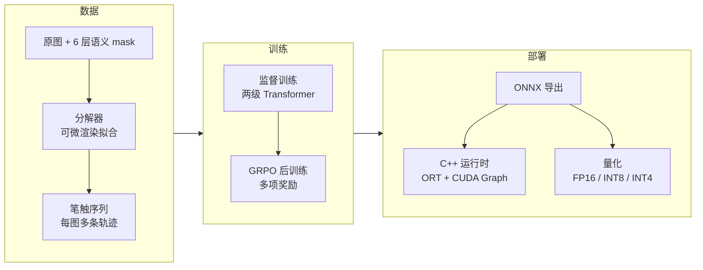

<div align="center">


<h3>一个用可编辑的高斯笔触、按语义图层逐笔作画的自回归图像模型<br>以及从数据、训练到 C++ 推理和量化的整套部署工具链</h3>

<p>
<a href="LICENSE"></a>


</p>

<p>
<a href="#-亮点">亮点</a> •
<a href="#-架构">架构</a> •
<a href="#-关键结果">关键结果</a> •
<a href="#-快速开始">快速开始</a> •
<a href="#-路线图">路线图</a> •
<a href="docs/architecture.md">架构文档</a>
</p>

</div>

<p align="center">

<br>
<sub>分解器把一张训练范围外的 3D 卡通图拆成 2 个图层、864 笔广义高斯笔触（29.3 dB，8.1 s）：最左是原图，往右依次是笔触逐步叠加的过程</sub>
</p>

---

## ✨ 亮点

模型不直接输出像素，而是一笔一笔地输出**广义高斯笔触**（位置、大小、角度、边缘硬度、颜色、透明度），
并按 **背景 → 身体 → 皮肤 → 五官 → 头发 → 配饰** 的图层顺序作画。生成结果天然就是分层的，可以继续编辑，也可以只重画其中一层。

|  | |
|---|---|
| 🎨 **语义分层协议** | `LAYER_k` / `REDRAW_k` / `REFINE_k` 事件。可以只重画头发、只给背景补细节，导出分层 ORA / SVG |
| 🔷 **广义高斯 + 量化感知分解** | 边缘硬度 β 让同一种图元既能做柔边喷枪、也能做硬边色块；分解器训练时直接看量化后的结果，训练目标 24.9 → **30.2 dB** |
| 🧠 **两级 Transformer + 画布反馈** | 每一笔在主干里只占一个位置，序列短了 9 倍；每 32 笔渲染一次画布，通过门控交叉注意力送回主干 |
| ⚡ **自研算子** | Triton tile 光栅化（前向 + 反向）让分解器快 **64×**；同一份 CUDA 源码经 hipify 跑在海光 DCU 上，算子比 PyTorch 稠密实现快 **9–38×** |
| 🛡️ **防作弊的 GRPO** | 奖励分项各自归一化，用独立评委 CLIP 和留出属性验收，抓到了奖励作弊并提前停止 |
| 🚀 **C++ 运行时 + 量化** | ORT 1.32 + CUDA Graph + 原地 KV cache，吞吐 735 → **1010** records/s，输出与优化前逐条相同；FP16 / INT8 / INT4 用两层方法验收 |
| 🌐 **异构多机流水线** | RTX 5070 笔记本 + RTX 4090 + 海光 DCU 分工；每次传输都核对 SHA；本机关机时 autopilot 也能自己推进 |

## 🧭 架构



| 模型 | 主干（宽 / 层 / 头） | 属性解码器 | 可训练参数 | 文字编码器 |
|---|---|---|---:|---|
| small | 384 / 8 / 6 (GQA 2) | 2 层 | 20.4M | Chinese-CLIP，冻结 |
| base | 768 / 16 / 12 (GQA 4) | 2 层 | **126.4M** | Chinese-CLIP，冻结 |

完整的设计说明、逐模块参数表和创新点见 **[docs/architecture.md](docs/architecture.md)**（另有 [PDF 版](docs/architecture.pdf)）。

## 📊 关键结果

<table>
<tr><td valign="top" width="50%">

**多轨迹数据**（独立评委 CLIP）

| 轨迹 / 图 | 评委 R@5 | 训练-验证损失差 |
|---|---:|---:|
| 1 | 18.8% | 0.10 |
| 4 | **30.2%** | 0.02 |

4 → 12 条：R@1 3.6% → **9.4%**，验证损失却完全一样，
说明只看损失看不出这部分收益。

</td><td valign="top" width="50%">

**量化**（逐步保真度 + 分布指标两层验收）

| 精度 | KL | 备注 |
|---|---:|---|
| FP16 | 2e-5 | 几乎无损 |
| 动态 INT8 | 1.8e-3 | CPU 单图快 **63%** |
| 仅权重 INT8/4 | — | 这个规模下不划算 |

</td></tr>
<tr><td valign="top">

**C++ 运行时优化**（B=8，输出逐条相同）

| 改动 | records/s |
|---|---:|
| 起点 | 735 |
| 定形单步图 + CUDA Graph | 743 |
| 原地更新 KV cache | 822 |
| 属性头接 CUDA Graph | 877 |
| 只拷回需要的 logits | **1010** |

B=32：1118 → **1472**（+32%）

</td><td valign="top">

**GRPO 后训练**

| 指标 | SFT | GRPO @100 |
|---|---:|---:|
| 评委 R@1 | 7.8% | **13.0%** |
| 留出属性 | — | +1.9 pt |
| 孤儿笔触率 | — | −31% |

到 step 175 时，计入奖励的指标还在涨，评委指标却开始变差（奖励作弊），
所以在 step 100 提前停止。

</td></tr>
</table>

## 🚀 快速开始

```sh
# 测试与 demo（需要 PyTorch，CUDA 可选；numpy、pillow、pytest）
python -m pytest
python tools/build_prior_codebooks.py
python tools/render_demo.py    --out out/demo
python tools/decompose_demo.py --out out/decompose   # 合成场景分解报告

# 训练
python tools/train.py --data "data/.../decomp_*.npz" --config small --out runs/small

# 导出 ONNX 并构建 C++ 运行时
python tools/export_onnx.py --ckpt runs/small/last.pt --out out/onnx
cmake -S runtime -B runtime/build && cmake --build runtime/build -j
runtime/run.sh --help
```

<details>
<summary><b>更多：海光 DCU、训练启动、续接</b></summary>

- 部分 DTK 构建会尝试加载未提供的 FlashAttention 库；训练可加 `--sdpa-backend math` 改用 PyTorch 内置注意力。
- 一条完整轨迹的清理、覆盖检查、远程 SHA 校验和训练启动，可用
  `python tools/start_ready_training.py --plan <launch-plan.json>` 串起来，
  见[续接记录](docs/continuation_2026-11-15.md)。
- 接手请先读 [Claude 最新交接](docs/CLAUDE_HANDOFF.md)。

</details>

## 📁 目录结构

```
protocol.json            序列协议：画布、图元公式、属性词表、事件、图层（Python 与 C++ 共用）
python/lpp/
  model.py  canvas.py    两级 Transformer、画布编码与反馈
  sequence.py sample.py  语法状态机、序列构造、带 KV cache 的采样器
  color.py shape.py      Oklab 颜色空间；形状的 log 协方差参数化
  codebook.py codec.py   k-means 码本；连续参数 <-> token
  render/                参考光栅化器、Triton / CUDA / HIP tile 光栅化、后端选择
  decompose/             分层分解器：图片 + 图层标签 -> 有序、量化后的图元
csrc/raster/             原生 CUDA/HIP 光栅化算子
runtime/                 C++ 推理运行时（语法、采样、光栅化、ORT 会话）
tools/                   数据处理、训练、GRPO、ONNX 导出、量化、评估
ops/plan_v3/             多机流水线与 autopilot
bench/                   算子基准测试与优化报告
docs/                    设计文档与实验记录
```

## 🗺️ 路线图

- [x] 序列协议、Oklab 颜色码本、log 协方差形状参数化
- [x] 可微参考光栅化器 + Triton tile 算子（前向/反向，[分解器快 64×](bench/REPORT_raster.md)）
- [x] 原生 CUDA/HIP 算子，同一份源码跑在 NVIDIA 和海光 DCU 上（[移植记录](docs/hip_port_log.md)）
- [x] 分层分解器：量化感知拟合、amodal 补全、图层越界约束
- [x] CelebAMask-HQ 3 万张 × 12 条轨迹；动漫 5 万张 × 4 条轨迹，约 56 万条序列
- [x] 两级模型（tiny / small / base）、Chinese-CLIP 文字条件 + CFG、画布反馈
- [x] [协议 v2](docs/protocol_v2.md)：独立形状分档、版本化颜色码本
- [x] GRPO 后训练与独立评委评估（[记录](docs/rl_log.md)）
- [x] ONNX 导出、C++ 运行时、CUDA Graph、FP16/INT8/INT4 量化（[运行时](docs/runtime_design.md) · [量化报告](docs/quant_report.md)）
- [ ] base 模型按 [训练计划 v3](docs/plan_v3_training.md) 训练（进行中）
- [ ] 通用题材：COCO + 8 槽位协议 v3（[设计](docs/protocol_v3_design.md)）
- [ ] 属性采样移进计算图；TensorRT 后端；CPU SIMD 光栅化
- [ ] 多卡 DDP 扩展效率实测

## 📚 文档

| 主题 | 文档 |
|---|---|
| 系统架构与创新点 | [architecture.md](docs/architecture.md) |
| 协议设计 | [protocol_v2.md](docs/protocol_v2.md) · [protocol_v3_design.md](docs/protocol_v3_design.md) |
| 画布反馈 | [canvas_feedback_design.md](docs/canvas_feedback_design.md) |
| 训练与强化学习 | [training_pipeline.md](docs/training_pipeline.md) · [rl_log.md](docs/rl_log.md) · [plan_v3_training.md](docs/plan_v3_training.md) |
| 部署与性能 | [runtime_design.md](docs/runtime_design.md) · [quant_report.md](docs/quant_report.md) · [perf_log.md](docs/perf_log.md) |
| 数据 | [anime_data_log.md](docs/anime_data_log.md) · [data_lessons.md](docs/data_lessons.md) · [image_cond_log.md](docs/image_cond_log.md) |

## 📜 许可与致谢

思路受 [Primitive Operation Painter 2](https://github.com/wonderfulearth/primitive-operation-painter) 启发，本项目的代码从头实现。

代码采用 [Apache License 2.0](LICENSE) 发布，第三方组件的说明见 [NOTICE](NOTICE)。

训练数据（CelebAMask-HQ、动漫数据集）仅限非商业研究用途，不随仓库分发；发布权重时会注明数据来源和使用限制。

<div align="center">
<sub>Built from scratch by <a href="https://github.com/G1en-114">@G1en-114</a></sub>
</div>
