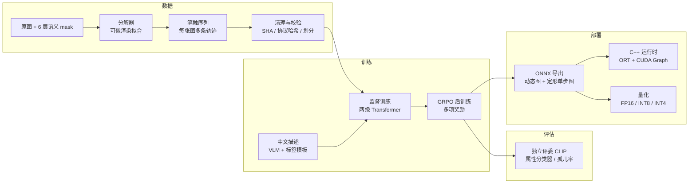

# 分层图元画家：架构与创新点

这个项目从零做了一个“会一笔一笔作画”的生成模型。模型不直接输出像素，
而是按图层顺序，一笔一笔输出**广义高斯笔触**（位置、大小、角度、边缘硬度、颜色、透明度）；
把这些笔触按顺序叠起来，就得到最终的画。

整条链路都是自己做的：数据生产、训练、强化学习、评估，到 C++ 推理引擎和量化。项目的目的是展示 AI 部署和高性能计算方面的能力。

本文分两部分：架构（每一层做什么，为什么这样设计）和创新点（哪些是我们自己的，哪些借鉴了已有工作）。
文中的数字都来自仓库里可以复现的实验，出处见各节引用的文档。

---

## 1. 总体架构

### 1.1 画面表示：带图层的广义高斯笔触

- **图元**：二维广义高斯，参数有中心 (x, y)、两个尺度 (σx, σy)、旋转角 θ、边缘硬度 β、颜色、透明度 α。
  β 小时笔触边缘柔和，像喷枪；β 大时边缘硬，像色块。用同一种图元就能画出柔和的皮肤和锐利的发丝。
- **合成**：在 sRGB 空间做 premultiplied over 叠加。这个运算满足结合律，所以“整张图一起渲染”、
  “按图层渲染再叠加”、“分块渲染”得到的结果完全一样。分层分解、按层重画、画布反馈都建立在这一点上。
- **图层**：人脸按语义分成 6 层，从下往上依次是背景、身体、皮肤、五官、头发、配饰（来自 CelebAMask-HQ 的标注）。
  动漫图的六层是自动生成的伪标签：用 anime-seg 分出人物，用 28 个关键点切出五官，再用颜色聚类找出头发。

### 1.2 协议：笔触怎样变成 token（`docs/protocol_v2.md`）

- 每个属性单独量化：x、y 各 512 档；σ、θ 各 128 档；β 8 档；颜色用 4096 色的 Oklab 码本；α 16 档。
- 事件有 20 种：PRIMITIVE（一笔）、LAYER_k（进入第 k 层）、REDRAW_k（重画第 k 层）、REFINE_k（细化第 k 层）、EOS（结束）。
  语法规定了合法的顺序（图层只能往上走、某几层必须画到等），解码时用语法 mask 排除不合法的选择。
- 协议文件和码本都算 SHA；数据、checkpoint、ONNX 导出都带着这个哈希，跨机器、跨版本时防止混用。

### 1.3 数据：分解器和多条轨迹

- **分解器**（`python/lpp/decompose/layered.py`）：按图层用可微渲染拟合原图。每层分几轮；
  每轮在误差最大的地方放置新笔触，用 Adam 优化 80 步；最后 30% 的步数用量化后的参数渲染（直通估计），
  所以训练目标在量化之后的画质就是拟合时看到的画质（人脸约 30 dB）。
- **多条轨迹**：同一张图换随机种子、或者水平翻转后重新分解，得到不同的笔触序列。
  现在人脸是 3 万张 × 12 条，动漫是 5 万张 × 4 条，一共约 56 万条序列。
- **清理**：遮挡之后几乎看不见的笔触（可见面积小于 2 个像素）删掉，约占 4%。删除导致 PSNR 下降超过 0.1 dB 的那张图保留原样。
- **中文描述**：人脸用 Qwen2.5-VL 写的描述，动漫用约 100 个 Danbooru 标签组合成的描述；
  每条描述前面加上领域词（“真人照片”或“动漫”），让模型学会按提示词切换画风。

### 1.4 模型：两级 Transformer + 画布反馈（`python/lpp/model.py`）

| | small | base |
|---|---:|---:|
| 主干：宽度 / 层数 / 头数（kv 头数） | 384 / 8 / 6（2） | 768 / 16 / 12（4） |
| 属性解码器层数 | 2 | 2 |
| 参数量 | 20.4M | 126.4M |
| 上下文长度 | 1024 | 1024 |

- **主干**：一个笔触占一个位置（GQA、RoPE、RMSNorm、SwiGLU），读入此前所有的笔触和事件。
- **属性解码器**：在每个位置上，用一个小的因果解码器依次输出事件，再输出 8 个属性
  （x → y → σx → σy → θ → β → 颜色 → α），后面的属性能看到前面已经采样出的值。
  训练时一次完整的前向就能同时监督全部属性；推理时 8 个属性依次采样。
- **文字条件**：冻结的 Chinese-CLIP 文字塔，特征池化成 32 个 token 放在前缀；训练时 10% 去掉文字，推理时用 CFG。
- **画布反馈**：每 32 个笔触，以及每个控制事件处，把当前已画的内容渲染成 64×64 的画布，用一个小 CNN 编码成 64 个 token。
  主干每隔几层用一个门控交叉注意力去读它。训练时和推理时看到的画布逐像素一致，有测试保证。
- **历史扰动**：30% 的训练序列会随机扰动一段前缀，被扰动的那些笔触不作为监督目标，让模型学会从不完美的画布继续画。

### 1.5 训练与后训练（`docs/rl_log.md`、`docs/plan_v3_training.md`）

- **监督训练**：AdamW，余弦学习率，bf16。数据中途扩充时，autopilot 在下一个 checkpoint 自动重新合并数据并接着训练。
- **GRPO**：每条提示词采 8 个样本，组内归一化优势。奖励有三项，分开做组内归一化后再加权：
  1. CLIP 图文相似度；
  2. 属性分类器的一致率；
  3. 孤儿率，即被后面的笔触完全盖住的笔触占比。

  record 的对数概率是重放语法 mask 后精确算出来的。

### 1.6 评估

192 条固定的验证集提示词，固定随机种子，有无 CFG 分开看。指标包括：
- 训练时用的 CLIP（ViT-B/16）；
- **独立评委 CLIP**（ViT-L/14，没有参与训练和奖励）；
- 属性分类器（在 CelebA 上微调的 ResNet-18）；
- 孤儿率、序列长度。

生成的图都存到磁盘，换评委时不用重新生成。

### 1.7 部署（`docs/runtime_design.md`、`docs/quant_report.md`）

- **导出**：6 个动态形状的图（嵌入、文字、主干、带 cache 的主干、属性头、画布编码器）。
  另外导出**定形的单步图**：主干的单步版本 `chunk_inplace_r<R>` 和属性头 `decode_heads_r<R>`，
  RoPE 和注意力分别融合成 `RotaryEmbedding` 和 ONNX `Attention`（opset 23）。
- **C++ 运行时**（`runtime/`）：语法、采样、码本解码、光栅化都在 C++ 里实现；ORT 1.32；
  KV cache 常驻显存，原地更新；按图分别放在 CPU 或 GPU 上（`cuda-auto`）；单步图用 CUDA Graph。
- **量化**（`tools/quantize_onnx.py`、`tools/quant_eval.py`）：FP16、动态 INT8、仅权重 INT8 和 INT4，用两层方法验收（见 2.6）。

### 1.8 多机基础设施（`ops/plan_v3/`）

三台异构机器：本机 RTX 5070 笔记本（开发、部署实验）、SCNet 海光 DCU（主训练）、租用的 RTX 4090（数据工厂）。
- 数据按分片号划分到不同机器，各自写完再汇总。
- 同一份 CUDA 源码在 DCU 上通过 hipify 编译。
- 每一次传输都核对 SHA，带 `.complete` 标记。
- SCNet 上的 autopilot 在本机关机时也能独立完成：等数据、合并、训练、在 checkpoint 处吸收新数据、最终评估。

---

## 2. 创新点

先说明来源：用自回归模型逐笔画图，以及“给前缀、让模型续画”来做超分和局部重绘，
都受 POP 2（primitive-operation painter）的启发。下面列的是这个项目在它之上新做的部分，以及我们实测得到的结论。

### 2.1 语义分层的绘画协议（分层 + 按层重画和细化）

- **做了什么**：把“画一张画”拆成按语义图层的顺序来画（背景 → 身体 → 皮肤 → 五官 → 头发 → 配饰），
  协议里有 `LAYER_k`、`REDRAW_k`、`REFINE_k` 这几种事件；训练时随机混入“重画某一层”和“在某一层的粗稿上补细节”的样本。
- **为什么成立**：premultiplied over 满足结合律，所以每一层可以单独渲染、单独替换，最后结果不变。
- **带来什么**：可以只改头发、只改背景这样局部地编辑；画的过程也可以解释（先铺底色，再画五官）。
  临摹实验：只给文字时与原图 10.2 dB；给出前三层后模型续画 18.7 dB；给出头发的粗稿后模型补细节 23.2 dB（`docs/image_cond_log.md`）。

### 2.2 广义高斯图元，加上量化感知的分解

- 用带边缘硬度 β 的广义高斯代替普通高斯，柔和的和锐利的笔触都能画。
- 分解器在最后 30% 的优化步里，用量化后的参数渲染（直通估计），并且每个属性单独量化。
  这样训练目标在 token 化之后几乎不掉画质：协议 v1 的形状码本会损失 6.6 dB；v2 把训练目标从 24.9 dB 提高到 30.2 dB（`docs/protocol_v2.md`）。

### 2.3 两级 Transformer 加画布反馈

- 一个笔触占一个位置（而不是一个属性占一个位置），序列短了 9 倍；属性之间的依赖交给小解码器处理。
- 画布反馈：模型能看到“目前画成了什么样”，而不只是看到 token 历史。训练时和推理时的画布逐像素一致。

### 2.4 多轨迹数据，以及实测的收益曲线

- 同一张图用不同的随机种子和翻转生成多条轨迹，防止模型把某一次随机拟合的结果当作唯一答案去记。
- **实测**（同一套评估，独立评委）：
  - 1 → 4 条：评委 R@5 从 18.8% 提高到 30.2%，训练和验证损失的差距从 0.10 缩小到 0.02；
  - 4 → 12 条（small 模型，各训练 12k 步）：评委 R@1 从 3.6% 提高到 9.4%，属性一致率从 0.725 提高到 0.751，**但验证损失完全一样**。
- **结论**：收益在递减，但确实存在，而且光看损失是看不出来的。由此决定把人脸加到约 24 条为止，不追 POP 2 的 150 条。

### 2.5 防作弊的 GRPO

- 用重放语法 mask 精确算出的 record 对数概率；奖励分项各自做组内归一化。
  不分项时，CLIP 奖励的方差约是属性奖励的 8 倍，属性信号会被淹没。
- **验收不信任奖励本身**：用没参与训练的独立评委 CLIP，并留出 4 个属性不放进奖励。
- **实测发现了奖励作弊**：到 step 100，评委 R@1 从 7.8% 提高到 13.0%；到 step 175，计入奖励的属性还在涨，评委指标却开始变差。
  所以在 step 100 提前停止，并把“每 25 步用评委快速评估一次，变差就停”定为后续的配方。

### 2.6 部署：量化的两层验收方法

- 量化后采样在第 2–3 步就会走上不同的分支，所以“逐 token 一致”不能拿来验收量化。
- **第一层，单步保真度**：记录 FP32 生成时每个图实际收到的输入，喂给量化后的图，逐步比较
  （输出头看 KL 和 top-1 一致率，其它张量看相对误差）。每一步单独比较，误差不会沿序列累积。
- **第二层，分布指标**：48 条提示词，比较生成分布（CLIP 分数、长度）。
- 结果：FP16 的 KL 是 2e-5（几乎无损）；动态 INT8 的 KL 是 1.8e-3，在 CPU 上单张图快 63%（VNNI 指令）；
  仅权重量化在这个规模不划算（解码受启动延迟限制，不受带宽限制）。还有一个方法上的结论：在 Python 循环里测速，结论会反过来。

### 2.7 部署：以剖析为依据、结果逐条相同的运行时优化

每一步都先剖析出瓶颈，再改，然后检查生成的记录是否与改动前逐条相同，最后测吞吐（3 次中位数）：

| 改动 | 解决的瓶颈 | B=8 records/s |
|---|---|---:|
| 起点 | — | 735 |
| 按图放到 CPU 或 GPU | 小图在 GPU 上被启动延迟拖慢 | 765 |
| 定形单步图，融合 RoPE 和注意力，接 CUDA Graph | 241/857 个节点在 CPU 上，用不了 CUDA Graph；每步 489 个小算子 | 743 |
| 原地更新 KV cache（图只读 cache，用 `cudaMemcpy2D` 写入新的那一格） | ping-pong 每步都要整拷 cache（R=64 时约 1 GB 流量） | 822 |
| 属性头也定形，接 CUDA Graph | 属性头占 62% | 877 |
| 只拷回需要的那个 logits | 每次调用把 9 个输出全拷回主机 | **1010** |

B=32 时从 1118 提高到 1472（+32%）；主干单步从 1.33 ms 降到 0.77 ms。
其中有一步单独看反而变慢，正是这一步暴露了 ping-pong 整拷的问题。
排查中还发现：ORT 的 CUDA EP 默认开 TF32，会让采样分叉；这个环境里加载不了 cuDNN；布尔型 `Where` 没有 kernel。

### 2.8 工程：可自动推进的异构多机流水线

- 三台不同架构（NVIDIA 笔记本、NVIDIA 4090、海光 DCU）的机器分工生产数据、训练、评估。
- 每一次传输都核对 SHA，带 `.complete` 标记；SCNet 上的 autopilot 在本机关机时独立推进，并在 checkpoint 处吸收新到的数据。
- 容错：一个 14 GB 的 core dump 写满了磁盘、截断了 checkpoint，之后改成：
  - 保存 checkpoint 时轮换出 `prev.pt`，保存前检查剩余空间；
  - 恢复时如果 `last.pt` 读不出来，就退回 `prev.pt`；
  - 关掉 core dump；监控在磁盘用到 90% 时报警。

---

## 3. 局限和下一步

- 题材目前只有人脸和动漫；通用题材（COCO，8 个槽位的协议 v3）已经设计好，数据还没开始生产。
- 多卡训练：DDP 已经实现，正确性也验证过，但还没在真正的多卡机器上测扩展效率。
- 基于像素的图生图条件失败了（与原图 12.7 dB），临摹现在靠前缀续画。
- 部署：属性采样还没有搬进图里（每个记录要调用 9 次属性头）；TensorRT 被 cuDNN 依赖卡住；模型放大后要重新验证仅权重量化。
- 后续计划见 `docs/plan_v3_training.md`。
